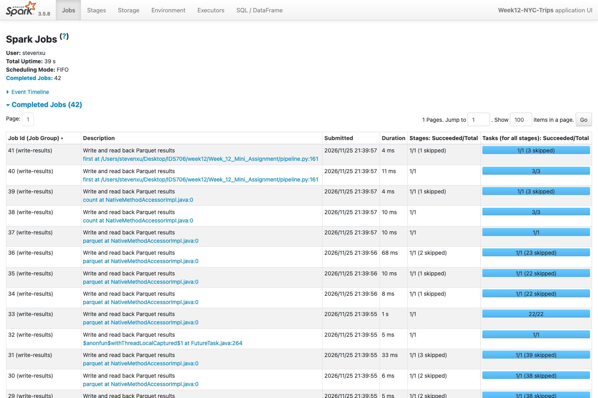
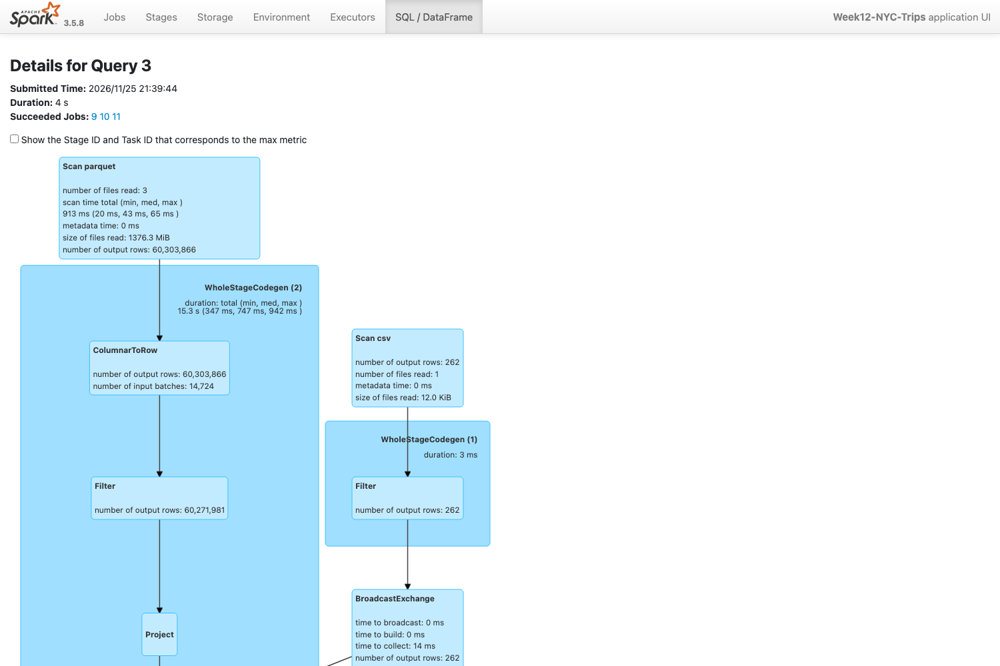
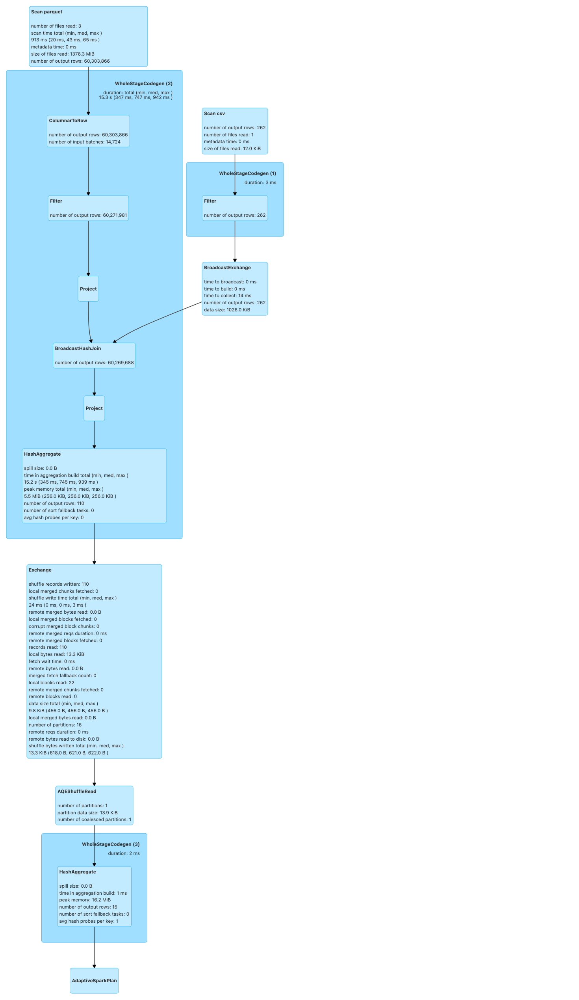

# Week 12: Simple PySpark Trip Pipeline

This project uses PySpark to analyze NYC for-hire trips with early filters, a broadcast join, aggregations, two SQL queries, caching, and Parquet output. It runs locally with four worker threads (`local[4]`), demonstrating Spark's partitioned execution on one computer rather than a multi-machine cluster. The submission uses Python scripts, so no notebook HTML export is needed.

## Dataset

Source: [NYC TLC Trip Record Data](https://www.nyc.gov/site/tlc/about/tlc-trip-record-data.page), [High Volume FHV data dictionary](https://www.nyc.gov/assets/tlc/downloads/pdf/data_dictionary_trip_records_hvfhs.pdf), and the [taxi-zone lookup](https://d37ci6vzurychx.cloudfront.net/misc/taxi_zone_lookup.csv).

Each trip row describes a trip dispatched by a high-volume for-hire service. The pipeline uses pickup time, pickup zone, distance, duration, and base passenger fare. Base fare excludes tolls, tips, taxes, and fees.

| Input | Download size |
| --- | ---: |
| [January 2024](https://d37ci6vzurychx.cloudfront.net/trip-data/fhvhv_tripdata_2024-01.parquet) | 472,757,547 bytes |
| [February 2024](https://d37ci6vzurychx.cloudfront.net/trip-data/fhvhv_tripdata_2024-02.parquet) | 462,475,428 bytes |
| [March 2024](https://d37ci6vzurychx.cloudfront.net/trip-data/fhvhv_tripdata_2024-03.parquet) | 507,940,560 bytes |
| **Total Parquet input** | **1,443,173,535 bytes (1.443 GB / 1.344 GiB)** |

These are real source files, not replicated or synthetic rows. There are **60,303,866 source trips**. TLC cautions that provider-submitted records may contain inaccuracies.

## Run

Requirements: Python 3.9–3.12, Java 17, and about 3 GB of free disk space for the environment and data. Tested with Python 3.11 and PySpark 3.5.8.

```bash
python3 -m venv .venv
source .venv/bin/activate
pip install -r requirements.txt
python download_data.py
mkdir -p artifacts
export SPARK_LOCAL_IP=127.0.0.1
python pipeline.py 2>&1 | tee artifacts/run.log
```

Java must be discoverable through `JAVA_HOME` or `PATH`. On this Mac, the existing Homebrew Java installation can be selected before running the pipeline:

```bash
export JAVA_HOME=/opt/homebrew/opt/openjdk@17/libexec/openjdk.jdk/Contents/Home
```

Downloads are skipped when an existing file has the expected size. Rerunning the pipeline overwrites its three output directories. Input data, outputs, the virtual environment, and bulky Spark runtime files are ignored by Git; code, screenshots, and small evidence files are ready to submit. No commit has been made.

To inspect the live Spark UI, run `python pipeline.py --ui-seconds 300` and open the URL printed in the log, normally `http://localhost:4040`. Open **SQL / DataFrame**, select `uncached-repeat`, and inspect the execution graph and Details. Open **Jobs** to see successful write and read-back jobs. Event logs are also saved in `artifacts/spark-events/` for a Spark History Server.

## Pipeline steps

1. Read three Parquet files and project only five trip columns.
2. Apply separate filters for Q1 pickup dates, positive distance, positive base fare, and trip durations of 60–10,800 seconds. Nulls in these required fields fail the filters.
3. Use `withColumn` to create pickup month, pickup hour, and duration in minutes.
4. Broadcast the small taxi-zone table and join pickup IDs to the five NYC boroughs. Trips with unknown or non-NYC pickup zones are excluded.
5. `groupBy` month and borough to calculate trip counts, total base fare, average distance, and average duration.
6. Compare identical aggregation actions with and without `.cache()`.
7. Run SQL query 1 to rank pickup hours by trip count and SQL query 2 to summarize trips and weighted average base fare by borough.
8. Write three Parquet summaries, then read back the monthly output and verify its row count and total trips.

| Output directory | Contents |
| --- | --- |
| `output/monthly_borough/` | 15 month/borough rows, partitioned by `pickup_month` |
| `output/borough_summary/` | Five borough rows from SQL query 2 |
| `output/hourly_demand/` | 24 pickup-hour rows from SQL query 1 |

## Transformations versus actions

`select`, `filter`, `withColumn`, `join`, and `groupBy().agg()` build a lazy execution plan. `count`, `collect`, and writing Parquet are actions that trigger computation. `.cache()` also stays lazy until an action materializes its results. Reading a schema can involve metadata work; the demonstration counts jobs only within its dedicated trip-processing job group.

The actual run printed:

```text
Lazy demo: jobs before=0, after transformations=0
After count action: 60,269,688 valid trips; jobs=3
```

One action can launch multiple jobs because Spark also needs broadcast and aggregation stages. Only small final summaries are collected to the driver.

## Performance analysis

Spark combined the early filters and pruned the trip scan to five columns, visible in `ReadSchema` in [physical_plan.txt](artifacts/physical_plan.txt). `PushedFilters` includes the pickup-date bounds, positive distance and fare, duration bounds, and null checks. These predicates are passed to the Parquet reader; they do not guarantee that row groups will be skipped. In this run, the scan still emitted all 60,303,866 source rows before the residual filter. The lookup is joined with `BroadcastHashJoin`, avoiding a shuffle of the large trip table. Spark also removed unused derived columns from the monthly query.

The large scan/filter/join/partial-aggregation stage was the main cost. Query 3's partial aggregation reported 15.2 seconds summed across tasks, versus 913 ms of scan time; these parallel task totals are not wall-clock times. The aggregation reduced the input to **110 partial rows**, and its shuffle wrote only **13.3 KiB**, with zero spill. Input was divided into **22 scan partitions** using a 64 MiB target. Starting with 16 shuffle partitions avoided the default 200-task overhead, and Adaptive Query Execution coalesced the tiny shuffle to **one partition**, shown by `AQEShuffleRead` in [adaptive_plan.txt](artifacts/adaptive_plan.txt). The tiny final summaries use `coalesce(1)` to avoid excess output files; the trip input remains parallel. Monthly output directories support partition pruning, verified in [partition_pruning_plan.txt](artifacts/partition_pruning_plan.txt).

Caching the 15-row monthly summary avoids rescanning and aggregating 60 million trips for later actions, including the second SQL query. The uncached repeat took **4.068 s**, while the cached repeat took **0.025 s**, about **162× faster**. Filling the cache separately cost **4.175 s**, so the gain applies to subsequent reuse, not the initial computation. Both measurements collect the same summary through a fresh query to avoid reusing an already executed adaptive query stage. [cached_plan.txt](artifacts/cached_plan.txt) confirms `InMemoryTableScan`. These are local observations with warm filesystem caches, not a controlled cluster benchmark. Full processing and output verification took **19.95 s**, excluding downloads, Spark startup, and the optional UI wait.

| Same monthly aggregation action | Seconds |
| --- | ---: |
| First uncached collect | 4.457 |
| Repeated uncached collect | 4.068 |
| Cache materialization | 4.175 |
| First cached collect | 0.031 |
| Repeated cached collect | 0.025 |

Exact timings, counts, and query results are saved in [metrics.json](artifacts/metrics.json). The [execution log](artifacts/run.log) includes `.explain()` output and the success message. [spark_sql_metrics.json](artifacts/spark_sql_metrics.json) preserves the actual Spark UI query metrics, including Query 3 used above. Background jobs completed successfully: **42 completed jobs and no failed queries**.

## Key findings

The pipeline retained **60,269,688 trips** and excluded **34,178** through the quality, date, and pickup-borough restrictions. These rules define this analysis sample rather than proving every excluded record was erroneous.

| Pickup borough | Trips | Average base fare |
| --- | ---: | ---: |
| Manhattan | 23,857,302 | $27.35 |
| Brooklyn | 15,887,382 | $21.30 |
| Queens | 12,201,349 | $27.30 |
| Bronx | 7,448,648 | $18.99 |
| Staten Island | 875,007 | $21.06 |

- Manhattan accounted for **39.58%** of retained trips.
- **18:00–18:59** was the busiest pickup hour across Q1, with **3,683,618 trips**.
- March had **21,274,070 trips**, compared with **19,650,588** in January and **19,345,030** in February. These are monthly totals, not adjusted for the number of days.
- Borough fares are weighted by trip counts; they are not unweighted averages of the three monthly averages.

## Screenshots from the successful run

**Successful pipeline execution:** completed jobs include the Parquet writes and read-back checks.



**Query Details:** the actual Spark UI equivalent of Databricks Query Details, for the repeated uncached aggregation.



**Full execution plan:** shows columnar scanning, filters, broadcast join, partial aggregation, small shuffle, and AQE partition coalescing. Open the image at full size to read individual metrics.


